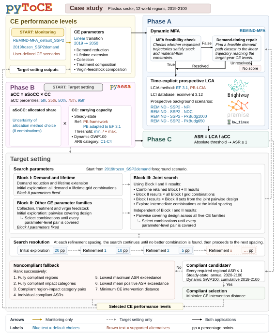

# Package Overview

**Issues and feedback:** Please report bugs, unexpected behavior, documentation gaps,
and installation or workflow issues on the [GitHub Issues page](https://github.com/Ike-EDB/pyToCE/issues).

## Package Scope

Circular economy (CE) strategies can reduce environmental burdens by reducing
resource demand and waste through changes in how materials are produced, used,
and recovered. Assessing their absolute environmental sustainability requires
quantifying these burdens and comparing them with allocated carrying capacities.
`pyToCE` links CE performance levels to annual material flows and environmental
burdens and performs this comparison.

The package combines dynamic material flow analysis (MFA), time-explicit
prospective life cycle assessment (LCA), and absolute environmental sustainability
assessment (AESA).
The package follows three calculation phases:

1. Phase A computes annual material-flow trajectories with `run_mfa` and the
   associated environmental burdens with `run_lca`.
2. Phase B provides allocated carrying capacities (aCC), calculated with the
   [pyaesa Python package](https://github.com/AESAtoolkit/pyaesa) through the
   optional tutorial or supplied by the user.
3. Phase C computes absolute sustainability ratios (ASRs), with `ASR = LCA / aCC`.

These phases can be used to assess user-defined CE transition pathways
(**monitoring**) or to search for CE performance levels whose environmental
burdens could comply with allocated carrying capacities (**target setting**).

The current version of `pyToCE` covers only the plastics sector. It models the
period from 2019 to 2100, with the world divided into 12 regions and plastics
represented by 12 distinct families distributed among seven end-use groups.
It builds on [REMIND-MFA 0.2.0](https://github.com/pik-piam/remind-mfa) and its
[input data 1.0.0](https://doi.org/10.5281/zenodo.18019915) to model stocks,
demand, virgin production, virgin feedstock composition, trade, collection,
recycling, incineration, landfill, open burning, and open dumping.

The LCA uses [ecoinvent 3.12](https://ecoinvent.org/database/) Allocation, cut-off
by classification in [Brightway](https://github.com/brightway-lca).
Prospective background inventories are generated with
[premise](https://github.com/polca/premise) and linked to the year of each life
cycle activity by [bw_timex](https://github.com/brightway-lca/bw_timex).

pyToCE can use the four REMIND SSP2 background scenarios available in
[premise 2.4.6](https://github.com/polca/premise),
covering climate policy pathways ranging from below 1.5 °C to above 3 °C of
warming by 2100.

Environmental burdens are characterized using the 16 EF 3.1 midpoint impact
categories and/or 10 PB-LCIA impact categories.

Environmental burdens are assigned to the year in which each life cycle
activity occurs (i.e., time-explicit). Plastics still in use at the end of 2100 remain in stock.
Recovery is represented by reduced virgin requirements in the MFA and by
treatment burdens in the LCA.

The [Methodological Notes](publications_and_resources.md) page provides the
underlying scientific article and Methodological appendix PDFs, the LCI workbook, and citation guide.

## Workflow Map

The figure below summarizes the main package data sources, public workflow
functions, study objectives, and output families.

[](_static/workflow.svg)

First, set up a workspace with `set_workspace`, download the public
input data with `download_data`, and prepare the background databases
with `prepare_backgrounds`. Then follow the steps for monitoring or
target setting:

- For **monitoring**, calculate the material flows with `run_mfa` and
  environmental burdens with `run_lca`, then call `run_asr` with the allocated
  carrying capacities to calculate annual and cumulative ASRs.
- For **target setting**, prepare the starting foreground and required MFA and
  baseline LCA results, then call `run_optimization` with the allocated carrying
  capacities. It searches for CE performance levels whose environmental burdens
  comply with those allocated carrying capacities, retaining a noncompliant
  fallback when no tested combination complies.

For both monitoring and target setting, allocated carrying capacities can be
calculated following the
{doc}`optional pyaesa tutorial <tutorials/optional_workflows/pyaesa_allocated_carrying_capacity>`
or supplied by the user. The pyaesa tutorial requires completed 2019 LCA results via `run_lca`.

The [Workflow Reference](workflow_reference.md) provides the main data sources,
workflow functions, and study objectives supported by `pyToCE`.

(installation)=
## Installation

Python 3.11 or 3.12 is required.

On macOS with Apple Silicon, install the LCA solver build requirements using
[Homebrew](https://brew.sh/):

```console
brew install suite-sparse swig pkg-config
```

Install the package from PyPI:

```console
python -m pip install pytoce
```

## ecoinvent License and Data

The full workflow requires an ecoinvent license. Download the ecoinvent 3.12
EcoSpold and LCIA archives locally and place them in `data_raw/ecoinvent/` in
your workspace before calling {func}`~pytoce.download_data`. `pyToCE` uses these
locally supplied archives. See the
[Workflow Reference](workflow_reference.md#2-download-public-inputs) for the
required filenames.

## License

`pyToCE` is distributed under the
[BSD 3-Clause License](https://github.com/Ike-EDB/pyToCE/blob/main/LICENSE).
Downloaded datasets remain governed by their original providers' terms and
conditions documented in [NOTICE](https://github.com/Ike-EDB/pyToCE/blob/main/NOTICE).
